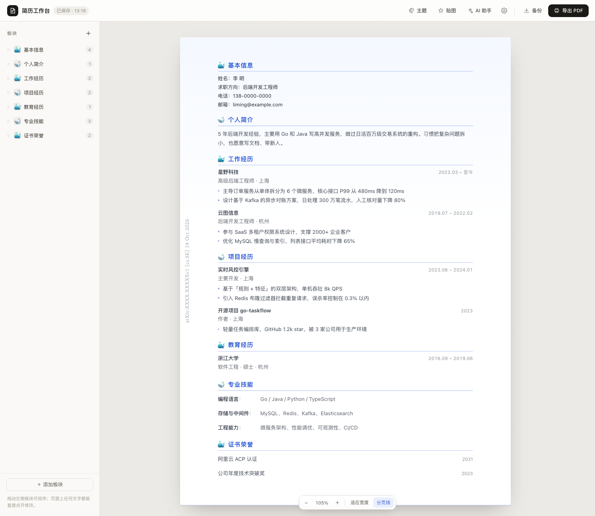

# 简历修改器

一个在自己电脑上用的简历编辑器：打开就能改，改完导出 PDF。日常编辑和保存都在本机，不上传。

## 快速开始

第一次用需要装 [Node.js](https://nodejs.org) 18 或更高版本（选 LTS，安装时一路下一步）。

- **macOS**：双击文件夹里的 `启动.command`
- **Windows**：双击 `启动.bat`

浏览器会自动打开。没打开就手动访问 <http://127.0.0.1:7788>。

> 不要直接双击 `public/index.html`，那样保存和 AI 会不正常。启动后的终端窗口要留着，关掉它就停止服务了。

## 开始改

- 左侧「＋ 添加板块」加板块；拖动排序，眼睛图标隐藏，垃圾桶删除。
- 纸上的字都能直接点开改。
- 鼠标移到板块标题或某一条的右侧，会出现操作按钮：加一条、上移、下移、复制、删除。
- 「基本信息」是普通板块，一行一个小模块（姓名、电话、邮箱……），点 ＋ 加一行，不需要的行删掉。
- 每一条经历有标题、时间、说明和分点。不需要时间或说明，点它们旁边的 × 可以直接删掉；想恢复，点条目右侧的滑杆按钮重新打开。不想要分点，点列表按钮切换。
- 「核心能力」「个人简介」这种文字板块，鼠标移到段落右侧也能点 + 加分点；分点同样可以切换圆点。
- 描述里按 Enter 新增一条，空行按 Backspace 合并。

## 换外观

- 顶部「主题」：背景、主色、字体字号、标题样式、行间密度、头像。
- 顶部「贴图」：内置小图案或上传图片，拖动、缩放、旋转。

## 可选：AI 助手

顶部「AI 助手」可以生成背景风格、小贴图，或润色一段文字。AI 需要本机先配置好，配置方法见开发者说明；没有配置不影响编辑和导出。

只有你主动使用 AI 时，输入或选中的内容才会发给 DeepSeek；不用 AI 时简历只在本机。

## 导出和备份

- 右上角「导出 PDF」：打印窗口选「另存为 PDF」，边距选「无」，勾选「背景图形」。
- 顶部「备份」导出备份文件；「设置」里可以导入，换电脑用它。
- 设置里也可以恢复示例简历或清空重来。

## 想从模板开始

软件文件夹里有一份 `模板-通用简历.json`：

设置 → 导入备份 → 选择它。里面都是占位文字，直接改。

## 常见问题

**打不开 / 双击没反应**
先装 Node.js 18+，装完重开终端/资源管理器。macOS 首次被拦截时，右键 `启动.command` → 打开。不要直接开 `public/index.html`。

**页面提示未连接**
终端窗口可能被关了；重新双击启动脚本，再点页面上的「重新检测」。

**AI 用不了 / 检测失败**
先看「设置 → AI 连接」的检测提示；AI 需要本机先配置好，详见开发者说明。不用 AI 不影响编辑和导出。

**内容超过一页**
把「行间密度」调成紧凑，或删减内容；页面右下角的分页线可以开关。

**Windows 双击一闪而过**
确认 Node.js 已安装好，然后在本文件夹打开终端运行 `node server.mjs` 看具体提示。

## 开发者 / 高级

下面这些是个性化或开发者功能，普通使用可以完全忽略：

- arXiv 式左侧标记、小鲸鱼
- 基本信息逐行字体/字号/字重/颜色、统一覆盖
- 条目字段的底层开关、时间另起一行
- AI 的 DSH token / API Key
- 数据文件结构、Git 同步、打包

详见 [开发者说明.md](开发者说明.md)。
